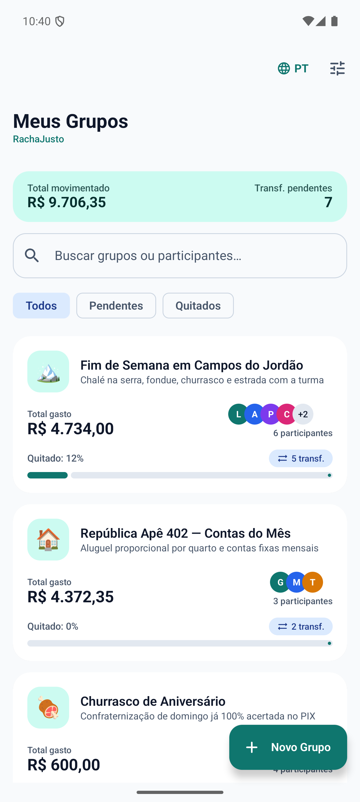
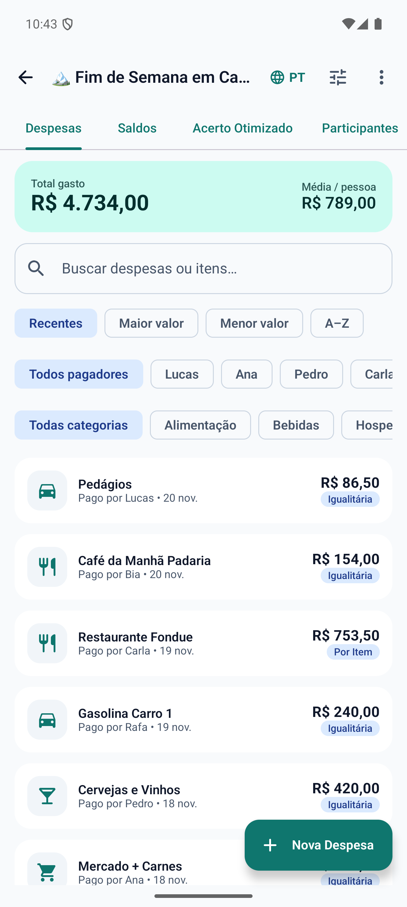
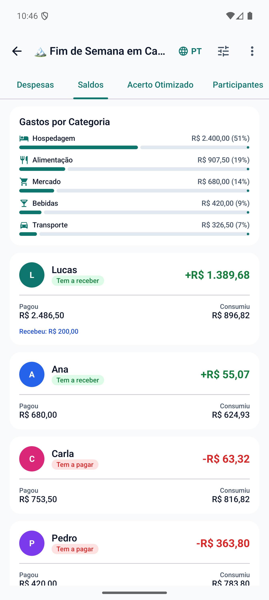
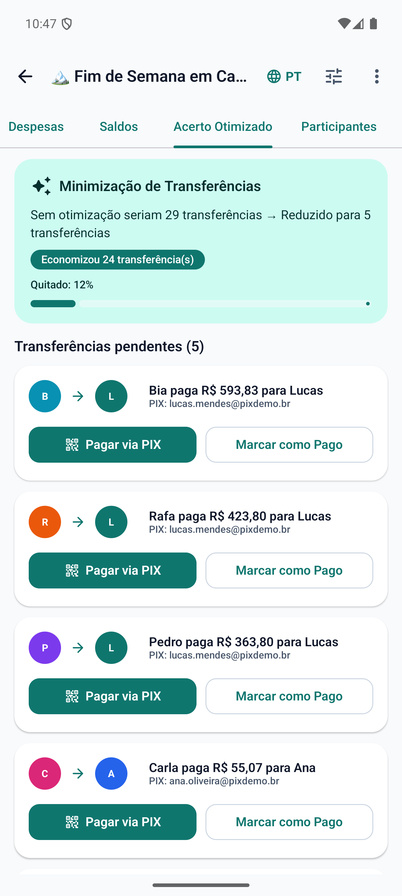
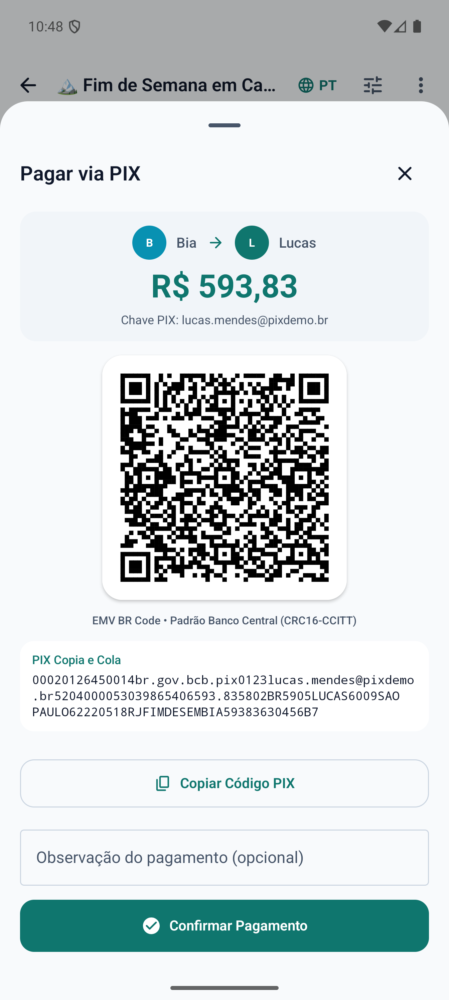
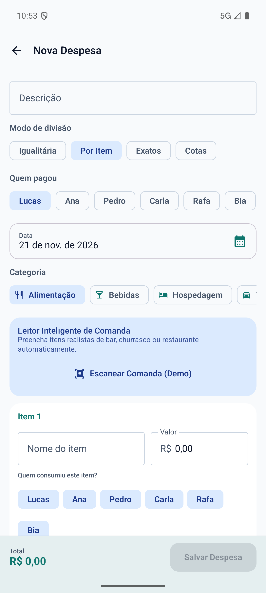

# RachaJusto

**RachaJusto** is a native Android application built with Kotlin, Jetpack Compose, and Material 3 for smart group bill splitting, cash-flow transfer minimization, and local EMV PIX BR Code generation.

## Screenshots

| My Groups (Home & Overview) | Group Expenses (Search, Sort & Filters) | Balances & Category Breakdown |
| :---: | :---: | :---: |
|  |  |  |

| Optimized Settlement (Cash-Flow Reduction) | Local EMV PIX QR Code & Copy-Paste | New Expense (4 Split Modes & Receipt Scanner) |
| :---: | :---: | :---: |
|  |  |  |

## Overview

Splitting group expenses during trips, barbecues, or shared apartment living quickly becomes chaotic when participants consume different items (for example, non-drinkers vs. drinkers) or hold unequal shares. Without transfer minimization, a group of six people often performs dozens of cross-payments when only a handful are mathematically necessary.

RachaJusto addresses this with:
- **100% Integer-Cents Monetary Arithmetic (`Long`)**: All BRL (`R$`) amounts are stored and calculated in cents to eliminate floating-point drift.
- **Four Expense Splitting Modes**:
  - **Equal (`EQUAL`)**: Select participating members with deterministic remainder distribution.
  - **Itemized / Receipt (`ITEMIZED`)**: Split individual line items per consumer with proportional service fee (%) and optional discount, plus a demo receipt scanner (`MockReceiptScannerService`).
  - **Exact Amounts (`EXACT`)**: Explicit per-participant amounts with live remaining counter, one-tap **Split equally** distribution, and save guard until balanced to the exact cent.
  - **Shares / Weights (`SHARES`)**: Integer weights (`0x`–`20x`) apportioned via the Largest Remainder Method.
  - **Quick Amount Entry**: Fast `+R$ 20`, `+R$ 50`, `+R$ 100`, and Clear chips for rapid expense input.
- **Cash-Flow Transfer Minimization & Savings Metrics**: Compares naive expense-level transfers against optimized minimum transfers, quantifies saved transactions and transfer reduction percentage, and tracks live settlement progress.
- **Local EMV PIX BR Code & QR Code**: Pure Kotlin EMVCo static PIX payload generator (Central Bank of Brazil standard with CRC16-CCITT, custom traceable `txid`, and optional payment notes) paired with local ZXing QR matrix rendering on Compose `Canvas` and automatic PIX key type classification (`CPF`, `CNPJ`, `Email`, `Phone`, `EVP`).
- **Analytics, Search, Sorting & Export**:
  - Home portfolio summary card (total tracked volume and pending transfers) with search and status filters (`All`, `Pending`, `Settled`).
  - Expense search, sorting (`Recent`, `Highest`, `Lowest`, `A–Z`), payer/category filters, one-tap expense duplication, and group metadata editing/deletion.
  - Visual category spending breakdown card on the Balances tab.
  - WhatsApp-ready share summary and RFC-4180 UTF-8 CSV export on the Participants tab.
- **4 Selectable Languages & 3 Theme Modes at Runtime**: Switch instantaneously between **Portuguese (Brazil)**, **English**, **Spanish**, and **French**, as well as **System**, **Light**, and **Dark** Material 3 themes, persisted locally across restarts.
- **Mock-First Architecture with Local Persistence**: Runs completely offline in Phase 1 with realistic latency simulation, versioned JSON persistence (`rachajusto_v1.json`) with integrity-audited snapshot import/export, pre-populated dynamic seed datasets, and a discreet Demo Mode control panel.

## Layered Architecture

```text
app/src/main/java/com/rachajusto/
├── core/
│   ├── designsystem/   # Material 3 light/dark color schemes, AppThemeMode, tabular typography, reusable UI components
│   ├── di/             # Manual dependency injection container (AppContainer)
│   ├── i18n/           # 4-language runtime localization (AppLanguage, LanguageManager, ProvideAppLanguage)
│   └── util/           # BRL integer-cent currency formatting and localized date formatting
├── domain/
│   ├── model/          # Pure Kotlin domain contracts (Group, Expense, SettlementSummary, etc.)
│   ├── engine/         # Pure Kotlin engines:
│   │                   #   SplitCalculator, CashFlowMinimizer, TransferSavingsMetrics,
│   │                   #   PixBrCodeGenerator, PixKeyValidator, PixTxIdGenerator,
│   │                   #   GroupAnalyticsEngine, GroupCsvExporter, GroupFilterEngine,
│   │                   #   GroupIntegrityAuditor, GroupValidationRules, ExpenseSorter, ExpenseDuplicator
│   ├── repository/     # GroupRepository interface
│   └── service/        # ReceiptScannerService interface
├── data/
│   ├── local/          # GroupStorage & FileJsonGroupStorage (versioned rachajusto_v1.json + snapshot backup)
│   ├── network/        # MockNetworkSimulator (configurable latency + one-shot error injection)
│   ├── repository/     # MockGroupRepository
│   ├── seed/           # SeedDataFactory (3 realistic groups with dates relative to LocalDate.now())
│   └── service/        # MockReceiptScannerService
├── feature/
│   ├── groups/         # Home groups list, portfolio overview, search/filters, create group sheet
│   ├── groupdetail/    # 4-tab detail screen (Expenses, Balances & Analytics, Optimized Settlement, Participants & Export)
│   ├── addexpense/     # 4-mode expense creation screen with quick chips, DatePicker, and receipt scanner
│   ├── pix/            # Local EMV PIX QR Code canvas, custom TxID, payment note, and confirmation sheet
│   └── demo/           # Demo Mode, theme switcher, and language selector top bar actions & bottom sheet
└── navigation/         # Navigation Compose routes and graph (RachaJustoNavHost)

app/src/androidTest/java/com/rachajusto/
├── GroupsFlowInstrumentedTest.kt           # End-to-end Compose UI tests for Home, search/filter, create group & Demo Mode
└── GroupDetailAndPixInstrumentedTest.kt    # End-to-end Compose UI tests for all 4 detail tabs, PIX QR sheet & 4 split modes
```

ViewModels and Composables depend exclusively on `domain` interfaces (`GroupRepository`, `ReceiptScannerService`) and pure domain engines—never directly on storage files, JSON DTOs, or mock data.

## Core Financial Algorithms

### 1. Exact-Cent Splitting & Remainder Distribution (`SplitCalculator`)
- **Equal Split**: Dividing `R$ 100,00` (`10000L`) across 3 participants yields `[3334L, 3333L, 3333L]`, distributing remainder cents deterministically in ascending participant ID order so the sum always equals the total.
- **Proportional Apportionment (Shares, Service Fees & Discounts)**: Uses exact integer **Largest Remainder Method** (Hamilton apportionment) with `BigInteger` numerator/remainder math and deterministic participant ID tie-breaking. Every itemized expense with service fee (%) and optional discount guarantees `splits.sumOf { it.amountCents } == grandTotalCents`.

### 2. Cash-Flow Minimization (`CashFlowMinimizer`)
1. Calculates net balance per participant:
   `net = totalPaid - totalConsumed + settlementsSent - settlementsReceived`
2. Asserts the zero-sum invariant: `balances.sumOf { it.netBalanceCents } == 0L`.
3. Separates debtors (`net < 0`) and creditors (`net > 0`).
4. **Pass 1 (Exact-Magnitude Matching)**: Immediately pairs any debtor and creditor with identical absolute amounts into a single transfer.
5. **Pass 2 (Greedy Settlement)**: Repeatedly matches the largest remaining debtor with the largest remaining creditor for `min(debt, credit)` until all balances reach zero.
6. Computes `naiveTransferCount`, `progressPercent`, and `TransferSavingsMetrics` to show real transfer savings and settlement completion.

### 3. EMVCo PIX BR Code Generator (`PixBrCodeGenerator`)
- Formats static EMVCo TLV fields:
  - `00`: Payload Format Indicator (`01`)
  - `26`: Merchant Account Information (`00 = br.gov.bcb.pix`, `01 = pixKey` or valid demo fallback)
  - `52`: MCC (`0000`), `53`: Currency (`986` BRL), `54`: Transaction Amount (`%.2f`), `58`: Country (`BR`)
  - `59`: Normalized ASCII Merchant Name (no diacritics, uppercase, max 25 chars)
  - `60`: Normalized ASCII Merchant City (max 15 chars)
  - `62`: Additional Data Field (`05 = txid` generated by `PixTxIdGenerator`, up to 25 alphanumeric characters)
  - `63`: CRC16-CCITT checksum (polynomial `0x1021`, initial value `0xFFFF`).

## Seed Data & Demo Mode

On first launch (or after resetting demo data), `SeedDataFactory` populates three realistic groups with dates dynamically calculated relative to `LocalDate.now()`:
1. **Fim de Semana em Campos do Jordão** (`🏔️`, 6 participants, 7 expenses including an itemized Fondue restaurant bill with 10% service fee, exact-cent toll split, non-drinker drink exclusion, and 1 partial settlement payment).
2. **República Apê 402 — Contas do Mês** (`🏠`, 3 participants, 4 monthly expenses including room-size weighted rent `3:2:2`).
3. **Churrasco de Aniversário** (`🍖`, 4 participants, 3 expenses, 100% settled via 3 recorded PIX payments to showcase the Settled state and Completed Payments history).

Tap the discreet sliders icon (`Demo Mode`) in the TopAppBar to:
- Switch app language (`Português (Brasil)`, `English`, `Español`, `Français`).
- Switch theme mode (`System`, `Light`, `Dark`).
- Switch simulated network latency (`Normal 300ms`, `Slow 1500ms`, `Instant 0ms`).
- Arm **Simulate Network Error** so the next request fails, demonstrating Snackbar feedback with Retry recovery.
- **Reset Sample Data** to restore the initial seed immediately.

## Build, Unit Tests & Instrumented Tests

Requirements: JDK 17 and Android SDK (`compileSdk 36`, `minSdk 26`).

```bash
# Assemble debug APK
./gradlew assembleDebug

# Run all 25 JVM unit test suites (60 unit tests)
./gradlew testDebugUnitTest

# Run Compose UI instrumented tests on a connected device or emulator (6 tests)
./gradlew connectedDebugAndroidTest
```

You can also install and execute the instrumented test APK directly via `adb`:

```bash
./gradlew assembleDebug assembleDebugAndroidTest
adb install -r app/build/outputs/apk/debug/app-debug.apk
adb install -r app/build/outputs/apk/androidTest/debug/app-debug-androidTest.apk
adb shell am instrument -w com.rachajusto.test/androidx.test.runner.AndroidJUnitRunner
```

### Test Coverage Summary
- **Domain Engines (13 suites)**: `SplitCalculatorTest`, `CashFlowMinimizerTest`, `TransferSavingsMetricsTest`, `PixBrCodeGeneratorTest`, `PixKeyValidatorTest`, `PixTxIdGeneratorTest`, `GroupAnalyticsEngineTest`, `GroupCsvExporterTest`, `GroupFilterEngineTest`, `GroupIntegrityAuditorTest`, `GroupValidationRulesTest`, `ExpenseSorterTest`, `ExpenseDuplicatorTest`.
- **Data & Storage (3 suites)**: `MockGroupRepositoryTest`, `FileJsonGroupStorageTest`, `MockReceiptScannerServiceTest`.
- **ViewModels & Utilities (9 suites)**: `GroupsViewModelTest`, `GroupDetailViewModelTest`, `AddExpenseViewModelTest`, `DemoModeViewModelTest`, `ShareSummaryFormatterTest`, `QrCodeMatrixGeneratorTest`, `CurrencyFormatterTest`, `AppLanguageTest`, `AppThemeModeTest`.
- **Instrumented UI Tests (`androidTest`, 2 suites / 6 tests)**:
  - `GroupsFlowInstrumentedTest`: Verifies seeded groups rendering, search & settled status filtering, Create Group bottom sheet, and Demo Mode runtime language switching.
  - `GroupDetailAndPixInstrumentedTest`: Verifies navigation across all 4 Group Detail tabs, Category Spending Breakdown analytics, PIX QR Code bottom sheet payload & copy interaction, and Add Expense switching across all 4 split modes.

## Phase 2 Integration Guide (Real Backend, Sync & PIX Webhooks)

Because UI and domain layers depend strictly on interfaces wired in `AppContainer`, upgrading from Phase 1 (mock-first) to Phase 2 production infrastructure requires swapping only implementations inside `core/di/AppContainer.kt`:

1. **Remote Persistence & Real-Time Sync**:
   - Implement `com.rachajusto.domain.repository.GroupRepository` with a `RemoteGroupRepository` backed by REST/GraphQL/Firestore + Room offline cache and WebSocket/snapshot listeners.
   - Replace `MockGroupRepository` with `RemoteGroupRepository` inside `AppContainer.groupRepository`.
2. **Real Receipt OCR**:
   - Implement `com.rachajusto.domain.service.ReceiptScannerService` (or extend with camera URI input) backed by ML Kit Document Scanner / Vision OCR API.
   - Replace `MockReceiptScannerService` in `AppContainer.receiptScannerService`.
3. **Dynamic PIX Charges & Webhook Confirmation**:
   - Introduce a `PixChargeGateway` service calling your PSP / Banco Central PIX Cobrança API (`POST /cob/{txid}`) to obtain dynamic EMV BR Codes with unique `txid`.
   - Confirm `SettlementPayment` records automatically when backend PIX webhooks settle the charge, while preserving `PixBrCodeGenerator` as an offline static-PIX fallback.
